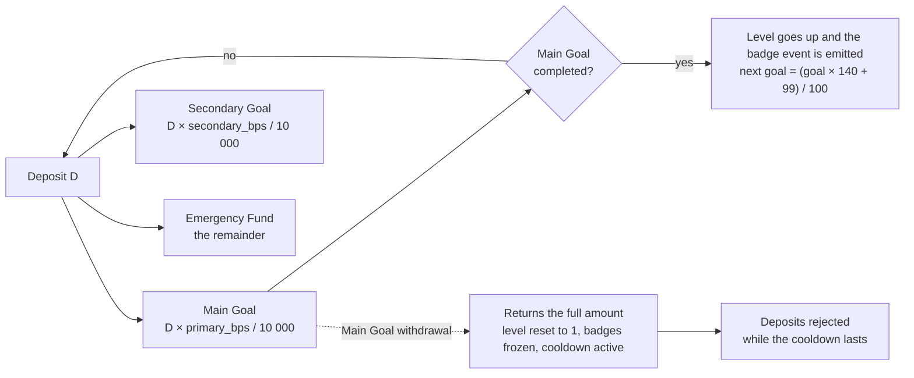

<div align="center">

# Ladder Chain

**Savings ladder — Soroban.**

🌐 [🇨🇱 Español](README.md) · 🇬🇧 English

Three funds per user, levels that go up when the goal is met, and an on-chain cooldown, on the Stellar network.



<br/>


</div>

---

## Table of contents

- [What is Ladder Chain](#what-is-ladder-chain)
- [Key features](#key-features)
- [How it works](#how-it-works)
- [Tech stack](#tech-stack)
- [Installation and setup](#installation-and-setup)
- [Usage](#usage)
- [Testnet deployments](#testnet-deployments)
- [TTL and known limits](#ttl-and-known-limits)
- [License](#license)
- [Author](#author)

---

## What is Ladder Chain

A Soroban contract with three funds per user: **Main Goal**, **Secondary Goal** and **Emergency Fund**. The SEP-41/SAC asset, `primary_bps`, `secondary_bps` and `cooldown_ledgers` are set only once through `initialize`; the Emergency percentage is the remainder up to 10,000 bps. There is no admin function that modifies that configuration.

---

## Key features

- **Three funds per user:** Main Goal, Secondary Goal and Emergency Fund.
- **Immutable configuration.** The SEP-41/SAC asset, `primary_bps`, `secondary_bps` and `cooldown_ledgers` are set only once with `initialize`, and no admin function can modify them.
- **Exact split.** A deposit is divided among the three funds and the total credited is exactly `D`.
- **Levels and badges.** Only completing the Main Goal raises a level and emits the badge event.
- **On-chain cooldown.** Any withdrawal from the Main Goal activates a cooldown during which deposits are rejected.
- **No progress penalty** for withdrawals from the Secondary Goal and Emergency: they don't alter progress.
- **Authorization.** Fund operations require `user.require_auth()`.
- **No admin with access to funds** and no promise of yield.

---

## How it works

### Amounts and deposit split

Amounts are expressed as `i128` in the asset's smallest unit. Deposits and withdrawals reject amounts less than or equal to zero. A deposit credits:

| Destination | Amount credited |
|---|---|
| Main Goal | `D * primary_bps / 10_000` |
| Secondary Goal | `D * secondary_bps / 10_000` |
| Emergency | The remainder |

This way, the total credited is exactly `D`. The user sets their initial goal with `abrir_meta`.

### Levels and badges

Only completing the Main Goal raises a level and emits the badge event. The next goal is calculated rounding up: `(previous_goal * 140 + 99) / 100`, with typed errors on overflow.

### Withdrawals

- Withdrawals from the Secondary Goal and Emergency don't alter progress.
- Any withdrawal from the Main Goal returns the full amount, reduces that balance, resets the level to 1, freezes the badges and activates the on-chain cooldown.
- While the current ledger is lower than `cooldown_until_ledger`, deposits are rejected.

### Storage and authorization

State is stored per user in persistent storage; the TTL of the instance configuration and of the user state is renewed on deposit or withdrawal. Fund operations require `user.require_auth()`. No yield is promised and there is no admin function with access to funds.

---

## Tech stack

| Layer | Technology |
|---|---|
| Smart contract | Rust + Soroban, `soroban-sdk 27.0.6` (scaffold generated by Stellar CLI `28.0.0`) |
| Network | Stellar Testnet |
| Asset | SEP-41/SAC: USDC (Circle testnet issuer) and native XLM in test mode |
| Bindings | TypeScript, generated with Stellar CLI from the WASM (`packages/escalera-ahorro`) |
| Tooling | `cargo`, Stellar CLI, npm, PowerShell |
| Explorer | stellar.expert |

---

## Installation and setup

### Tests, build and bindings

```powershell
cargo test
stellar contract build
stellar contract bindings typescript --wasm target\wasm32v1-none\release\escalera_ahorro.wasm --output-dir target\escalera-ahorro-bindings-v2
Copy-Item target\escalera-ahorro-bindings-v2\src\index.ts packages\escalera-ahorro\src\index.ts -Force
Set-Location packages\escalera-ahorro
npm run build
```

Contract SDK: `soroban-sdk 27.0.6` (scaffold generated by Stellar CLI `28.0.0`). After changing the contract, regenerate the TypeScript bindings from the produced WASM: previously generated bindings describe an earlier ABI. `ver_estado` returns the three balances, the main goal, the level, the badge-freeze state and the ledger where the cooldown ends.

> The instances, transactions, verified flows and deployment commands documented below correspond to earlier ABIs. They are not compatible with the current contract; they are kept only as historical reference. Do not initialize those instances with the current ABI.

---

## Usage

### TypeScript bindings

The v2 bindings must be regenerated from the local v2 WASM with Stellar CLI. A v1 instance ID is not used to generate the ABI:

```powershell
stellar contract bindings typescript --wasm target\wasm32v1-none\release\escalera_ahorro.wasm --output-dir target\escalera-ahorro-bindings-v2
Copy-Item target\escalera-ahorro-bindings-v2\src\index.ts packages\escalera-ahorro\src\index.ts -Force
Set-Location packages\escalera-ahorro
npm run build
```

The package exports `Client`, `EstadoMeta` and `Errors` from `src/index.ts`. It does not export `networks` with a v1 address: configure the v2 instance address once it is deployed. Don't put secret keys in `VITE_*` variables.

### Contract functions

The published ABI exposes `initialize`, `abrir_meta`, `configurar_reparto`, `depositar`, `acceso_desbloqueado`, `retirar_desbloqueado`, `retirar_colchon`, `retirar_primer_paso`, `retirar_todo_emergencia` and `ver_estado`.

---

## Testnet deployments

**TESTNET — no real value.**

### USDC v2 instance — deployed on testnet

v2 uses a new instance because the storage structure and keys changed. It is not compatible with the v1 instance and its existing states cannot be migrated.

- Contract ID: `CDV3US33JHTD3IDIFPVVUDJ5EC4CBXVN4DYJ3ZUJRMHLYL2OJEVM7FGQ`
- Stellar CLI alias: `escalera-ahorro-usdc`
- USDC SAC: `CBIELTK6YBZJU5UP2WWQEUCYKLPU6AUNZ2BQ4WWFEIE3USCIHMXQDAMA`
- Testnet USDC issuer (Circle): `GBBD47IF6LWK7P7MDEVSCWR7DPUWV3NY3DTQEVFL4NAT4AQH3ZLLFLA5`
- v2 WASM hash: `c006d8d519d8101d077d6645729e66dcece8b5c83b2890d0cd726ae1358b3735`
- WASM installation: [transaction](https://stellar.expert/explorer/testnet/tx/fb4dd36823d0589dd311c06febd95221edf8c4529cc08a6e9d2134af00fd7586)
- Instance deployment: [transaction](https://stellar.expert/explorer/testnet/tx/a370ba78af5de26bc8a55a456be727f76cb0a3d8d216cbf9521b165f649042d5)
- Initialization with USDC: [transaction](https://stellar.expert/explorer/testnet/tx/8739458fa3347441cb253312e92280a8198720468e7ac357ae2c11c6becb8a8f)
- Instance TTL extension: [transaction](https://stellar.expert/explorer/testnet/tx/dd337e5279ee9c1e0ae545be6448304ee579bce38f8611e5f6cb843cd62403c4)
- WASM TTL extension: [transaction](https://stellar.expert/explorer/testnet/tx/1301ab149e3e2f6b83df8a037b987b59a0b50f269e73d44100bddb0cb7ab6897)

It was verified that a second initialization fails with `YaInicializado` (#2), as expected. The published ABI exposes `initialize`, `abrir_meta`, `configurar_reparto`, `depositar`, `acceso_desbloqueado`, `retirar_desbloqueado`, `retirar_colchon`, `retirar_primer_paso`, `retirar_todo_emergencia` and `ver_estado`. No goal was opened and no deposits or withdrawals were made during deployment.

### XLM instance (test mode)

An instance independent from v2 for testing with the native SAC. Do not use with real value; the USDC instance and the historical contract were not modified.

- Contract ID: `CCPB3FIQZDH7YU35QK7QAIZVQ2KNZSTI2MXGAP4NWJTCY67UAPNZEAQO`
- Stellar CLI alias: `escalera-ahorro-xlm`
- Native XLM SAC: `CDLZFC3SYJYDZT7K67VZ75HPJVIEUVNIXF47ZG2FB2RMQQVU2HHGCYSC` (symbol `native`)
- v2 WASM hash: `c006d8d519d8101d077d6645729e66dcece8b5c83b2890d0cd726ae1358b3735`
- Deployment: [transaction](https://stellar.expert/explorer/testnet/tx/b58d3dfe66e101ebb0738ae427fdfda27883b8d0586e9b095b2afafba81a493a)
- Initialization with XLM: [transaction](https://stellar.expert/explorer/testnet/tx/33ccc44a0b0ae40a0f38ca4749af21bb4cf315af182396399dd754221cb50b73)
- Instance TTL extension by 518400 ledgers (new reported expiry: ledger `5593760`): [transaction](https://stellar.expert/explorer/testnet/tx/891b4d8bd484bf07d7966cedb08a03301d822bcbdff9dfaa06653295e67bc55d)
- v2 WASM TTL confirmed through an RPC read: live until ledger `5571173` (read at ledger `5075355`).
- The simulation of a second `initialize` call failed with `YaInicializado` (`Error(Contract, #2)`), without sending a transaction.

Only deployment, initialization and TTL extension were done. `abrir_meta`, `depositar` and withdrawal functions were not called.

### History (obsolete)

The following corresponds to earlier ABIs and is kept only as historical reference.

#### Previous XLM instance (obsolete)

```powershell
stellar contract id asset --asset native --network testnet
stellar contract deploy --wasm target/wasm32v1-none/release/escalera_ahorro.wasm --source-account ahorro-admin --network testnet --alias escalera-ahorro
stellar contract invoke --id CADNB4D4ATSW4PWA3BESLDQNN64RXQEH7WSRAIEYN5KQA2VIDYCVTPYI --source-account ahorro-admin --network testnet -- initialize --token CDLZFC3SYJYDZT7K67VZ75HPJVIEUVNIXF47ZG2FB2RMQQVU2HHGCYSC
```

This instance and its XLM configuration are kept as historical reference; do not use for new integrations.

Previous contract ID: `CADNB4D4ATSW4PWA3BESLDQNN64RXQEH7WSRAIEYN5KQA2VIDYCVTPYI`.
Previous native XLM SAC: `CDLZFC3SYJYDZT7K67VZ75HPJVIEUVNIXF47ZG2FB2RMQQVU2HHGCYSC`.

#### USDC v1 instance (do not use with v2)

The following instance corresponds to the v1 ABI and storage. It is not compatible with v2 storage and is kept only as historical reference:

- Contract ID: `CBHGAYQYZHDABX2ZMFCQ5Z6WLXXGWIRKBJ3XTHVFMWHJCZ2G6H4DNQKC`
- USDC SAC: `CBIELTK6YBZJU5UP2WWQEUCYKLPU6AUNZ2BQ4WWFEIE3USCIHMXQDAMA`
- Testnet USDC issuer (Circle): `GBBD47IF6LWK7P7MDEVSCWR7DPUWV3NY3DTQEVFL4NAT4AQH3ZLLFLA5`
- Decimals: 7
- WASM hash: `baef2e28243e7122964cb865c27a1743e6098f45e0c1e92df548a98b56274fdd`
- Deployment: [transaction](https://stellar.expert/explorer/testnet/tx/652b776faa656f6bd7df506bbf9cfa754af243e54c2994af7e6fa9177b6bffb5)
- Initialization with USDC: [transaction](https://stellar.expert/explorer/testnet/tx/795d53b8e4631d47edefdd204da27b785169c2429402a10f54d3c01b598c6586)
- Instance TTL extension: [transaction](https://stellar.expert/explorer/testnet/tx/9ef258d163b8195531dc6f98e579611e1aa662c743c9f2caa04806011fcca5c6)
- WASM TTL extension: [transaction](https://stellar.expert/explorer/testnet/tx/1cb7aef77b20dcc2ce4c8ebadcee7cf054095f816a6041c661dd2f99234e8626)

The following TTL extensions belong to the v1 instance/WASM and are historical reference only:

```powershell
stellar contract extend --id CBHGAYQYZHDABX2ZMFCQ5Z6WLXXGWIRKBJ3XTHVFMWHJCZ2G6H4DNQKC --ledgers-to-extend 518400 --source-account ahorro-admin --network testnet
stellar contract extend --wasm-hash baef2e28243e7122964cb865c27a1743e6098f45e0c1e92df548a98b56274fdd --ledgers-to-extend 518400 --source-account ahorro-admin --network testnet
```

#### Verified testnet flow of the previous XLM instance

An account `prueba` was funded from Friendbot, opened a goal of `100000000` stroops and deposited that amount. The contract recorded level 1, one badge and next goal `170000000`; `acceso_desbloqueado` returned `10000000`. That limit was withdrawn and then the emergency fund returned the remaining `90000000`. The final state was `abierta=false`, with balance, level, badges and goal at zero.

---

## TTL and known limits

The instance and the WASM code are distinct ledger entries; extending either of them does not renew user states. Per-user persistent storage is renewed on every write, but views do not renew their entries. After enough inactivity, Soroban may expire that state while the SAC keeps the funds; the contract would no longer be able to determine the individual balance to return it. Authenticated/periodic renewal of the states needs to be planned. TTL behavior depends on activity and must not be considered a guarantee of fund recovery after expiry.

**Known limits:** testnet only; persistent state may expire due to inactivity; Primer Paso only accumulates and does not invest.

---

## License

Distributed under the **MIT** license. See the [`LICENSE`](LICENSE) file for details.

## Authors and acknowledgements

| | |
|---|---|
| **Sofía Candia** | Civil Engineering in Telematics, Universidad de La Frontera |
| **Consuelo Licanqueo** | Civil Engineering in Industrial Engineering, Universidad de La Frontera |

We thank **Stellar**, in partnership with **iDEAUFRO**, and the **Agrupación Bandurr[IA] UFRO**.

<div align="center">

&nbsp;&nbsp;&nbsp;
&nbsp;&nbsp;&nbsp;


<br/>

<div align="center">

*Ladder Chain: savings ladder on Soroban.*

</div>
