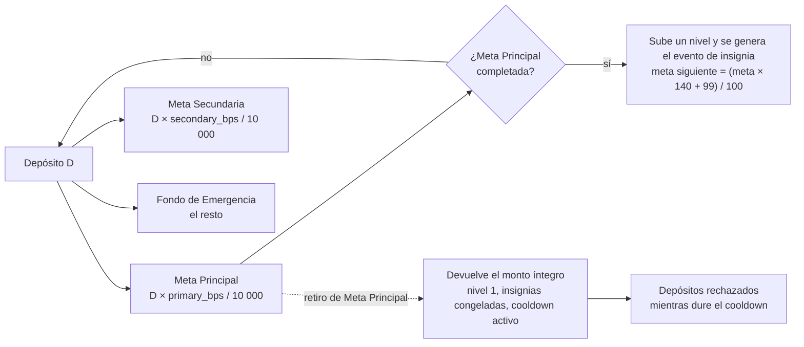

<div align="center">

# Ladder Chain

**Escalera de ahorro — Soroban.**

🌐 🇨🇱 Español · [🇬🇧 English](README.en.md)

Tres fondos por usuario, niveles que suben al cumplir la meta y un cooldown on-chain, sobre la red Stellar.



<br/>


</div>

---

## Tabla de contenidos

- [Qué es Ladder Chain](#qué-es-ladder-chain)
- [Características principales](#características-principales)
- [Cómo funciona](#cómo-funciona)
- [Tecnologías utilizadas](#tecnologías-utilizadas)
- [Instalación y configuración](#instalación-y-configuración)
- [Uso](#uso)
- [Despliegues en Testnet](#despliegues-en-testnet)
- [TTL y límites conocidos](#ttl-y-límites-conocidos)
- [Licencia](#licencia)
- [Autora](#autora)

---

## Qué es Ladder Chain

Contrato Soroban con tres fondos por usuario: **Meta Principal**, **Meta Secundaria** y **Fondo de Emergencia**. El activo SEP-41/SAC, `primary_bps`, `secondary_bps` y `cooldown_ledgers` se fijan una sola vez mediante `initialize`; el porcentaje de Emergencia es el residuo hasta 10 000 bps. No existe una función de administración que modifique esa configuración.

---

## Características principales

- **Tres fondos por usuario:** Meta Principal, Meta Secundaria y Fondo de Emergencia.
- **Configuración inmutable.** El activo SEP-41/SAC, `primary_bps`, `secondary_bps` y `cooldown_ledgers` se fijan una sola vez con `initialize`, y no hay función de administración que los modifique.
- **Reparto exacto.** Un depósito se divide entre los tres fondos y la suma acreditada es exactamente `D`.
- **Niveles e insignias.** Solo completar Meta Principal sube un nivel y genera el evento de insignia.
- **Cooldown on-chain.** Cualquier retiro de Meta Principal activa un cooldown durante el cual los depósitos se rechazan.
- **Retiros sin penalización de progreso** en Meta Secundaria y Emergencia: no alteran el progreso.
- **Autorización.** Las operaciones de fondos requieren `user.require_auth()`.
- **Sin administrador con acceso a fondos** y sin promesa de rendimiento.

---

## Cómo funciona

### Montos y reparto de depósitos

Los montos se expresan como `i128` en la unidad mínima del activo. Los depósitos y retiros rechazan montos menores o iguales a cero. Un depósito acredita:

| Destino | Monto acreditado |
|---|---|
| Meta Principal | `D * primary_bps / 10_000` |
| Meta Secundaria | `D * secondary_bps / 10_000` |
| Emergencia | El resto |

Así, la suma acreditada es exactamente `D`. El usuario establece su meta inicial con `abrir_meta`.

### Niveles e insignias

Solo completar Meta Principal sube un nivel y genera el evento de insignia. La meta siguiente se calcula con redondeo hacia arriba: `(meta_anterior * 140 + 99) / 100`, con errores tipados en caso de overflow.

### Retiros

- Los retiros de Meta Secundaria y Emergencia no alteran el progreso.
- Cualquier retiro de Meta Principal devuelve el monto íntegro, reduce ese saldo, reinicia el nivel a 1, congela las insignias y activa el cooldown on-chain.
- Mientras el ledger actual sea menor que `cooldown_until_ledger`, los depósitos se rechazan.

### Almacenamiento y autorización

El estado se almacena por usuario en almacenamiento persistente; el TTL de la configuración de instancia y del estado de usuario se renueva al depositar o retirar. Las operaciones de fondos requieren `user.require_auth()`. No se promete rendimiento y no hay función de administrador con acceso a fondos.

---

## Tecnologías utilizadas

| Capa | Tecnología |
|---|---|
| Contrato inteligente | Rust + Soroban, `soroban-sdk 27.0.6` (scaffold generado por Stellar CLI `28.0.0`) |
| Red | Stellar Testnet |
| Activo | SEP-41/SAC: USDC (emisor Circle de testnet) y XLM nativo en modo de prueba |
| Bindings | TypeScript, generados con Stellar CLI desde el WASM (`packages/escalera-ahorro`) |
| Herramientas | `cargo`, Stellar CLI, npm, PowerShell |
| Explorador | stellar.expert |

---

## Instalación y configuración

### Pruebas, build y bindings

```powershell
cargo test
stellar contract build
stellar contract bindings typescript --wasm target\wasm32v1-none\release\escalera_ahorro.wasm --output-dir target\escalera-ahorro-bindings-v2
Copy-Item target\escalera-ahorro-bindings-v2\src\index.ts packages\escalera-ahorro\src\index.ts -Force
Set-Location packages\escalera-ahorro
npm run build
```

SDK del contrato: `soroban-sdk 27.0.6` (scaffold generado por Stellar CLI `28.0.0`). Tras cambiar el contrato, regenera los bindings TypeScript desde el WASM producido: los bindings previamente generados describen un ABI anterior. `ver_estado` devuelve los tres saldos, la meta principal, el nivel, el estado de congelación de insignias y el ledger de fin del cooldown.

> Las instancias, transacciones, flujos verificados y comandos de despliegue documentados debajo corresponden a ABI anteriores. No son compatibles con el contrato actual; se conservan únicamente como referencia histórica. No inicialices esas instancias con el ABI actual.

---

## Uso

### Bindings TypeScript

Los bindings v2 deben regenerarse desde el WASM local de v2 con Stellar CLI. No se usa el ID de una instancia v1 para generar el ABI:

```powershell
stellar contract bindings typescript --wasm target\wasm32v1-none\release\escalera_ahorro.wasm --output-dir target\escalera-ahorro-bindings-v2
Copy-Item target\escalera-ahorro-bindings-v2\src\index.ts packages\escalera-ahorro\src\index.ts -Force
Set-Location packages\escalera-ahorro
npm run build
```

El paquete exporta `Client`, `EstadoMeta` y `Errors` desde `src/index.ts`. No exporta `networks` con una dirección v1: configura la dirección de la instancia v2 cuando se despliegue. No pongas claves secretas en variables `VITE_*`.

### Funciones del contrato

El ABI publicado expone `initialize`, `abrir_meta`, `configurar_reparto`, `depositar`, `acceso_desbloqueado`, `retirar_desbloqueado`, `retirar_colchon`, `retirar_primer_paso`, `retirar_todo_emergencia` y `ver_estado`.

---

## Despliegues en Testnet

**TESTNET — sin valor real.**

### Instancia USDC v2 — desplegada en testnet

La v2 usa una instancia nueva porque la estructura y las claves del almacenamiento cambiaron. No es compatible con la instancia v1 y sus estados existentes no son migrables.

- Contract ID: `CDV3US33JHTD3IDIFPVVUDJ5EC4CBXVN4DYJ3ZUJRMHLYL2OJEVM7FGQ`
- Alias Stellar CLI: `escalera-ahorro-usdc`
- SAC USDC: `CBIELTK6YBZJU5UP2WWQEUCYKLPU6AUNZ2BQ4WWFEIE3USCIHMXQDAMA`
- Emisor USDC testnet (Circle): `GBBD47IF6LWK7P7MDEVSCWR7DPUWV3NY3DTQEVFL4NAT4AQH3ZLLFLA5`
- Hash del WASM v2: `c006d8d519d8101d077d6645729e66dcece8b5c83b2890d0cd726ae1358b3735`
- Instalación del WASM: [transacción](https://stellar.expert/explorer/testnet/tx/fb4dd36823d0589dd311c06febd95221edf8c4529cc08a6e9d2134af00fd7586)
- Despliegue de la instancia: [transacción](https://stellar.expert/explorer/testnet/tx/a370ba78af5de26bc8a55a456be727f76cb0a3d8d216cbf9521b165f649042d5)
- Inicialización con USDC: [transacción](https://stellar.expert/explorer/testnet/tx/8739458fa3347441cb253312e92280a8198720468e7ac357ae2c11c6becb8a8f)
- Extensión TTL de la instancia: [transacción](https://stellar.expert/explorer/testnet/tx/dd337e5279ee9c1e0ae545be6448304ee579bce38f8611e5f6cb843cd62403c4)
- Extensión TTL del WASM: [transacción](https://stellar.expert/explorer/testnet/tx/1301ab149e3e2f6b83df8a037b987b59a0b50f269e73d44100bddb0cb7ab6897)

Se verificó que la segunda inicialización falla con `YaInicializado` (#2), como se espera. El ABI publicado expone `initialize`, `abrir_meta`, `configurar_reparto`, `depositar`, `acceso_desbloqueado`, `retirar_desbloqueado`, `retirar_colchon`, `retirar_primer_paso`, `retirar_todo_emergencia` y `ver_estado`. No se abrió ninguna meta ni se hicieron depósitos/retiros durante el despliegue.

### Instancia XLM (modo de prueba)

Instancia independiente de la v2 para pruebas con el SAC nativo. No usar con valor real; la instancia USDC y el contrato histórico no se modificaron.

- Contract ID: `CCPB3FIQZDH7YU35QK7QAIZVQ2KNZSTI2MXGAP4NWJTCY67UAPNZEAQO`
- Alias Stellar CLI: `escalera-ahorro-xlm`
- SAC XLM nativo: `CDLZFC3SYJYDZT7K67VZ75HPJVIEUVNIXF47ZG2FB2RMQQVU2HHGCYSC` (símbolo `native`)
- Hash del WASM v2: `c006d8d519d8101d077d6645729e66dcece8b5c83b2890d0cd726ae1358b3735`
- Despliegue: [transacción](https://stellar.expert/explorer/testnet/tx/b58d3dfe66e101ebb0738ae427fdfda27883b8d0586e9b095b2afafba81a493a)
- Inicialización con XLM: [transacción](https://stellar.expert/explorer/testnet/tx/33ccc44a0b0ae40a0f38ca4749af21bb4cf315af182396399dd754221cb50b73)
- Extensión TTL de la instancia en 518400 ledgers (nuevo vencimiento reportado: ledger `5593760`): [transacción](https://stellar.expert/explorer/testnet/tx/891b4d8bd484bf07d7966cedb08a03301d822bcbdff9dfaa06653295e67bc55d)
- TTL del WASM v2 confirmado mediante lectura RPC: vivo hasta el ledger `5571173` (lectura en el ledger `5075355`).
- La simulación de una segunda llamada a `initialize` falló con `YaInicializado` (`Error(Contract, #2)`), sin enviar transacción.

Solo se desplegó, inicializó y extendió el TTL. No se llamó a `abrir_meta`, `depositar` ni a funciones de retiro.

### Historial (obsoleto)

Lo siguiente corresponde a ABI anteriores y se conserva solo como referencia histórica.

#### Instancia anterior con XLM (obsoleta)

```powershell
stellar contract id asset --asset native --network testnet
stellar contract deploy --wasm target/wasm32v1-none/release/escalera_ahorro.wasm --source-account ahorro-admin --network testnet --alias escalera-ahorro
stellar contract invoke --id CADNB4D4ATSW4PWA3BESLDQNN64RXQEH7WSRAIEYN5KQA2VIDYCVTPYI --source-account ahorro-admin --network testnet -- initialize --token CDLZFC3SYJYDZT7K67VZ75HPJVIEUVNIXF47ZG2FB2RMQQVU2HHGCYSC
```

Esta instancia y su configuración XLM se conservan como referencia histórica; no usar para nuevas integraciones.

Contract ID anterior: `CADNB4D4ATSW4PWA3BESLDQNN64RXQEH7WSRAIEYN5KQA2VIDYCVTPYI`.
SAC nativo XLM anterior: `CDLZFC3SYJYDZT7K67VZ75HPJVIEUVNIXF47ZG2FB2RMQQVU2HHGCYSC`.

#### Instancia USDC v1 (no usar con v2)

La siguiente instancia corresponde al ABI y almacenamiento v1. No es compatible con el almacenamiento v2 y se conserva solo como referencia histórica:

- Contract ID: `CBHGAYQYZHDABX2ZMFCQ5Z6WLXXGWIRKBJ3XTHVFMWHJCZ2G6H4DNQKC`
- SAC USDC: `CBIELTK6YBZJU5UP2WWQEUCYKLPU6AUNZ2BQ4WWFEIE3USCIHMXQDAMA`
- Emisor USDC de testnet (Circle): `GBBD47IF6LWK7P7MDEVSCWR7DPUWV3NY3DTQEVFL4NAT4AQH3ZLLFLA5`
- Decimales: 7
- Hash del WASM: `baef2e28243e7122964cb865c27a1743e6098f45e0c1e92df548a98b56274fdd`
- Despliegue: [transacción](https://stellar.expert/explorer/testnet/tx/652b776faa656f6bd7df506bbf9cfa754af243e54c2994af7e6fa9177b6bffb5)
- Inicialización con USDC: [transacción](https://stellar.expert/explorer/testnet/tx/795d53b8e4631d47edefdd204da27b785169c2429402a10f54d3c01b598c6586)
- Extensión TTL de la instancia: [transacción](https://stellar.expert/explorer/testnet/tx/9ef258d163b8195531dc6f98e579611e1aa662c743c9f2caa04806011fcca5c6)
- Extensión TTL del WASM: [transacción](https://stellar.expert/explorer/testnet/tx/1cb7aef77b20dcc2ce4c8ebadcee7cf054095f816a6041c661dd2f99234e8626)

Las siguientes extensiones TTL pertenecen a la instancia/WASM v1 y son solo referencia histórica:

```powershell
stellar contract extend --id CBHGAYQYZHDABX2ZMFCQ5Z6WLXXGWIRKBJ3XTHVFMWHJCZ2G6H4DNQKC --ledgers-to-extend 518400 --source-account ahorro-admin --network testnet
stellar contract extend --wasm-hash baef2e28243e7122964cb865c27a1743e6098f45e0c1e92df548a98b56274fdd --ledgers-to-extend 518400 --source-account ahorro-admin --network testnet
```

#### Flujo testnet verificado de la instancia XLM anterior

Una cuenta `prueba` se financió desde Friendbot, abrió una meta de `100000000` stroops y depositó esa cantidad. El contrato registró nivel 1, una insignia y meta siguiente `170000000`; `acceso_desbloqueado` devolvió `10000000`. Se retiró ese límite y luego la emergencia devolvió los `90000000` restantes. El estado final quedó con `abierta=false`, saldo, nivel, insignias y meta en cero.

---

## TTL y límites conocidos

La instancia y el código WASM son entradas de ledger distintas; extender cualquiera de ellas no renueva los estados de usuario. El almacenamiento persistente por usuario se renueva en cada escritura, pero las vistas no renuevan sus entradas. Tras suficiente inactividad, Soroban puede expirar ese estado mientras el SAC conserva los fondos; el contrato ya no podría determinar el saldo individual para devolverlo. Se requiere planear renovación autenticada/periódica de los estados. El comportamiento TTL depende de la actividad y no debe considerarse una garantía de recuperación de fondos tras caducidad.

**Límites conocidos:** solo testnet; el estado persistente puede expirar por inactividad; Primer Paso solo acumula y no invierte.

---

**## Licencia

Distribuido bajo la licencia **MIT**. Consulta el archivo [`LICENSE`](LICENSE) para más detalles.

---

## Autoras y agradecimientos

| | |
|---|---|
| **Sofía Candia** | Ingeniería Civil Telemática, Universidad de La Frontera |
| **Consuelo Licanqueo** | Ingeniería Civil Industrial, Universidad de La Frontera |

Agradecemos a **Stellar**, en alianza con **iDEAUFRO**, y a la **Agrupación Bandurr[IA] UFRO**.

<div align="center">

&nbsp;&nbsp;&nbsp;
&nbsp;&nbsp;&nbsp;


<br/>

Hecho en Chile para el University Track del hackathon **Stellar · Find Your Way**.

Ladder Chain: escalera de ahorro sobre Soroban.
**
